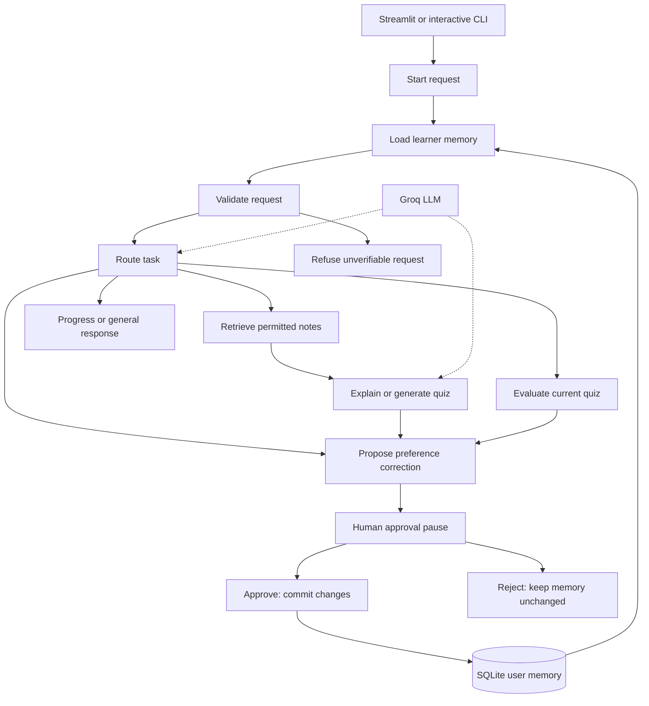

# Project 1 architecture

One logical tutor uses the Groq LLM for classification, topic resolution, explanations, quizzes and feedback. Python helper modules are not claimed as independent collaborating agents.

The proposal step ends without a pause when there is nothing useful/new to save. A missing-note or invalid-quiz result does not produce learning-progress memory.

| Boundary | Contents | Lifetime |
|---|---|---|
| Current thread | Request, recent chat, resolved topic, note excerpts, current quiz, pending proposal, approval and step trace | UUID-keyed RAM checkpoint plus Streamlit session |
| Reusable learner memory | Separate style, level and last-topic records; approved quiz progress | SQLite, keyed by learner ID |
| Permitted information source | Bundled Python `.txt` notes | Read-only repository content |
| External model | Task prompts, relevant learning preferences and note excerpts | Provider request; not a local-only computation |

**Changes from baseline:** explicit retrieval/memory nodes; UUID thread checkpoints; reviewed memory proposals; approve/reject branches; separate versioned preference records; memory correction UI and actual preference use in the tutor prompt.

`InMemorySaver` holds paused thread execution; SQLite holds reusable user memory. They serve different purposes. Pending execution is not recovered after a process restart, but approved memory is read by a newly built workflow.

The Mermaid diagram is the current architecture. The historical `eduagentsys.png` is not required to run this version.
